# WildGuard AI: roadside wildlife-collision warning, built with CraftifAI PipeGen

**Embedded SF: CraftifAI Physical AI Hackathon** · Open Innovation track

A roadside camera running a **CraftifAI PipeGen** pipeline (our own YOLOv8n, compiled to TensorRT FP16 on DeepStream) spots five at-risk Brazilian species near the road. It turns each confirmed sighting into a real-time alert on a road-safety dashboard. An ESP32 roadside warning unit, specified as a **CraftifAI FirmGen** PRD, is designed to close the loop with flashing lights and a buzzer.

▶ **[Watch the 2-minute demo](https://github.com/toonpurkasuperhero/CraftifAIHackathon_CRA003/releases/download/demo-video/wildguard_demo.mp4)**: the PipeGen pipeline running on real wildlife footage, the alerts raised from its live MQTT feed, the dashboard, and PipeGen's output file. Also stored at [docs/evidence/demo/wildguard_demo.mp4](docs/evidence/demo/wildguard_demo.mp4).

## Status at a glance

| Part | Status | Evidence |
|---|---|---|
| **PipeGen perception** (Track A) | ✅ All five stages done. Custom model compiled to TensorRT FP16 and running live at 30 FPS on real video | [PipeGen evidence](#pipegen-pipeline-evidence), [export folder](perception/pipegen_export/) |
| **MQTT → bridge → dashboard** | ✅ Working end to end on PipeGen's live output | [demo video](docs/evidence/demo/wildguard_demo.mp4), [dashboard](#dashboard) |
| **Real-video test** | ✅ 4 of 5 species alerted correctly at 0.63 s. One miss and 3 false alarms, reported below | [report](docs/evidence/video_test/pipegen/report.md) |
| **FirmGen ESP32 firmware** (Track B) | 🟡 PRD written (30 requirements). FirmGen project created and requirements review started. **Not yet built or flashed**, because no ESP32 board was available | [FirmGen progress](#firmgen-roadside-unit-in-progress) |
| **Closed loop** (camera → board acts) | ⏳ Designed and specified, not yet demonstrated on hardware | [architecture](#architecture) |

## Contents

1. [The problem and who it is for](#the-problem-and-who-it-is-for)
2. [Architecture](#architecture)
3. [PipeGen pipeline evidence](#pipegen-pipeline-evidence)
4. [How to run it](#how-to-run-it)
5. [Results](#results)
6. [Dashboard](#dashboard)
7. [FirmGen roadside unit (in progress)](#firmgen-roadside-unit-in-progress)
8. [Problems we hit and how we fixed them](#problems-we-hit-and-how-we-fixed-them)
9. [Limitations and next steps](#limitations-and-next-steps)
10. [Repository layout](#repository-layout)
11. [Credits](#credits)

## The problem and who it is for

Wildlife-vehicle collisions on Brazilian highways are a leading cause of death for large mammals. Two of the five species here, the lowland tapir and the giant anteater, are IUCN *Vulnerable*, and the maned wolf is *Near Threatened*. A collision with a 250 kg tapir also endangers the driver.

**User:** the road-safety and wildlife officer of a highway concession, plus the drivers on that road. Today they rely on static "animal crossing" signs that drivers ignore. Roadkill is counted afterwards from carcasses found on patrol, so they learn where animals died, not when one is on the road. WildGuard turns a roadside camera into a live sensor. The officer gets a timestamped alert and record of every crossing, and drivers can be warned while the animal is actually there.

Species: tapir, jaguarundi, maned wolf, puma and giant anteater, from the [BRA dataset](training/archive/README.md) (Ferrante et al., SIBGRAPI 2022, DOI 10.1109/SIBGRAPI55357.2022.9991774).

## Architecture

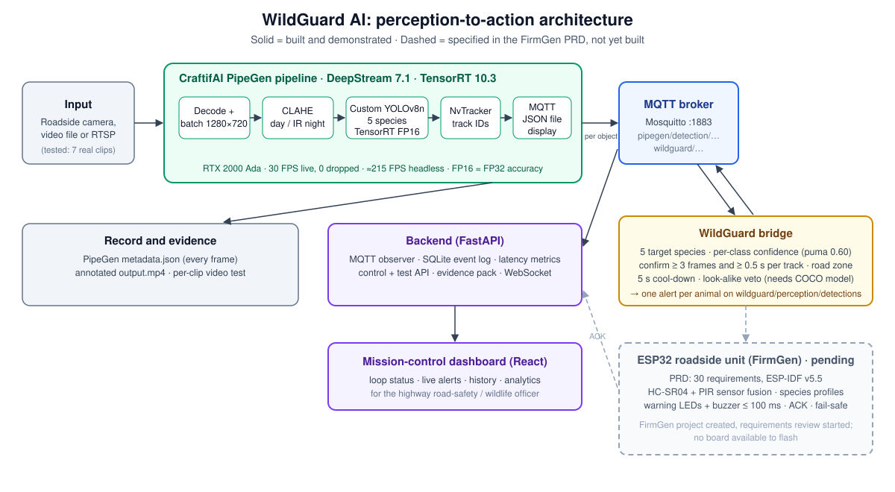

1. **PipeGen pipeline:** decodes video, applies CLAHE so infrared night footage and daylight look alike, detects the five species with our YOLOv8n on TensorRT FP16, tracks each animal, then publishes every object over MQTT, writes per-frame JSON and shows the annotated video.
2. **Bridge** ([bridge/bridge.py](bridge/bridge.py)): turns PipeGen's per-frame stream into **one alert per animal**. It keeps the five species and applies per-class thresholds. It confirms an animal only after at least 3 frames and 0.5 s, checks the road zone, and applies a 5 s cool-down per track.
3. **Backend** ([backend/](backend/main.py)): stores events in SQLite, measures latency and serves the dashboard live over a WebSocket. It also provides arm/disarm, test alerts and an evidence-pack export.
4. **Dashboard** ([frontend/](frontend/README.md)): the officer's view, with loop status, live alerts, history and analytics.
5. **ESP32 roadside unit (pending):** subscribes to the alerts, fuses them with its own ultrasonic and PIR sensors, drives warning LEDs and a buzzer within 100 ms, and sends an acknowledgement back. The contract is in [docs/mqtt-contract.md](docs/mqtt-contract.md).

## PipeGen pipeline evidence

PipeGen v0.5.1 on an NVIDIA RTX 2000 Ada, Ubuntu 24.04, with the `craftifaidocker/deepstream:7.1` image and TensorRT 10.3.0. All stage screenshots are indexed in [perception/screenshots/README.md](perception/screenshots/README.md).

### Pipeline IR node graph

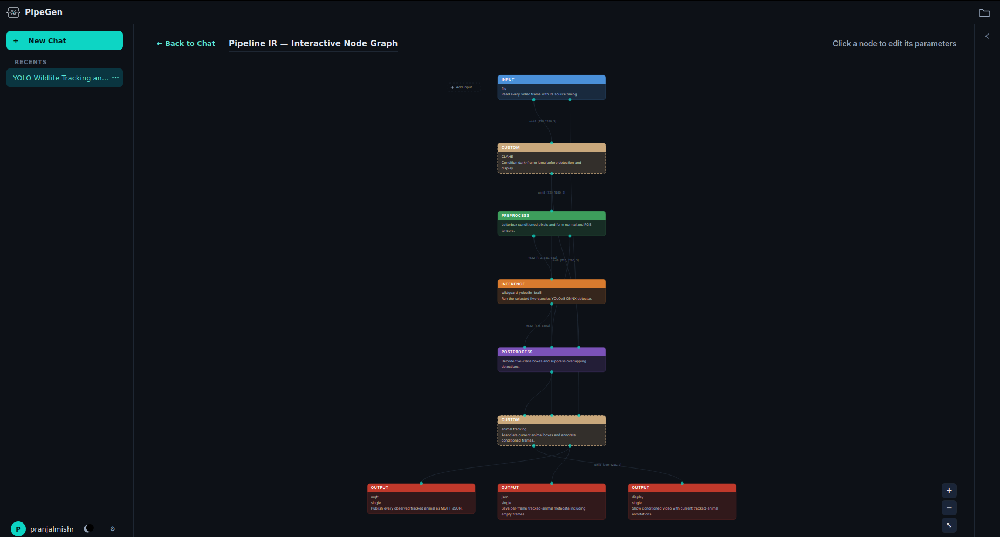

### Running live: TensorRT FP16, 30 FPS, 0 dropped frames

| Tapir (infrared, night) | Jaguarundi | Puma |
|---|---|---|
| 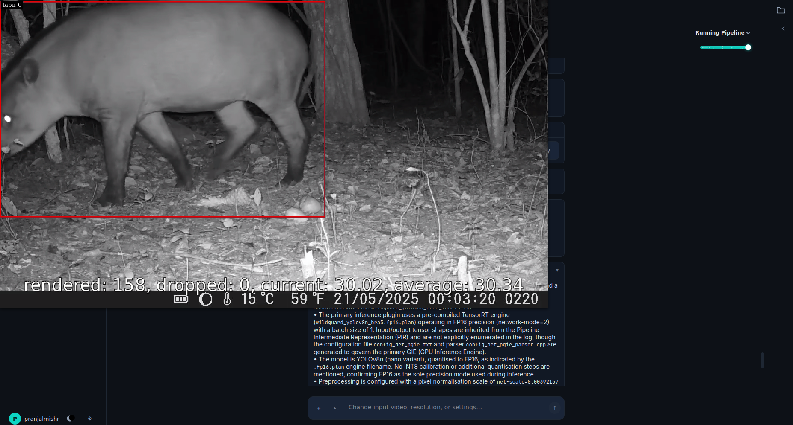 | 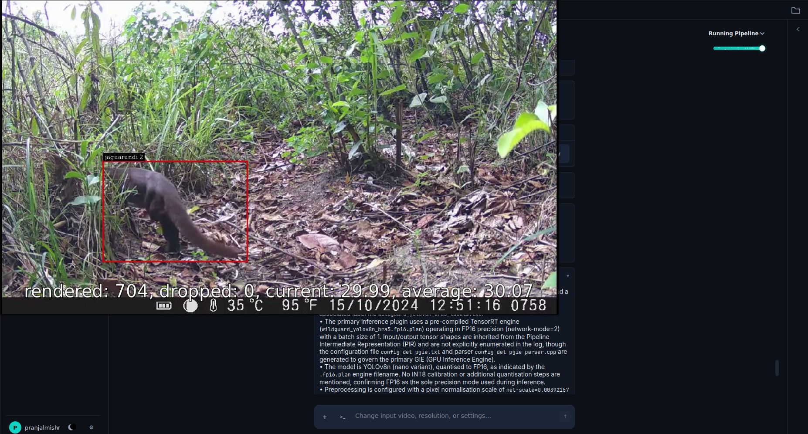 | 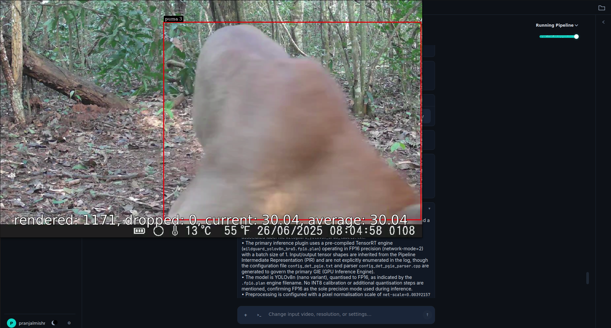 |

PipeGen's video console listing live detection events:

| Tapir events | Giant anteater events |
|---|---|
| 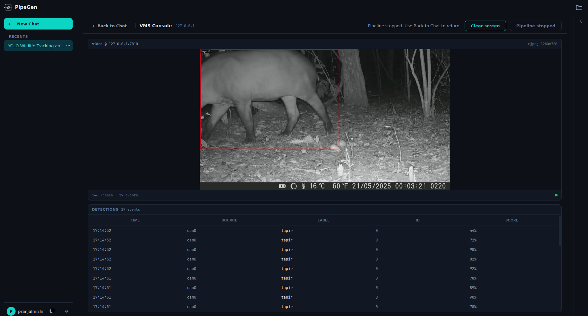 | 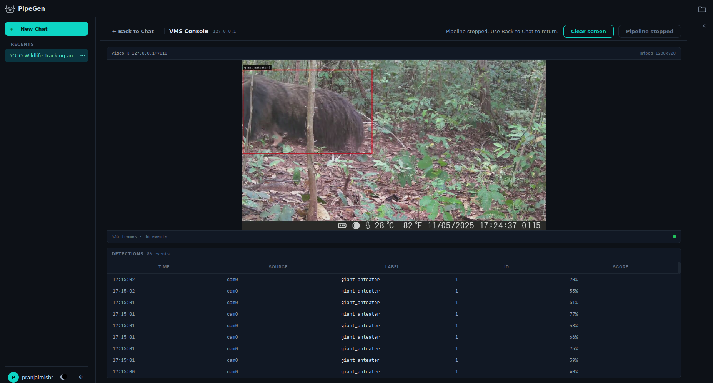 |

### Model and compiler reports

| ONNX check: 232/234 layers native on TensorRT, 0 unresolved | TensorRT FP16 engine: 8.4 s build, 10.9 MB, 174 layers |
|---|---|
| 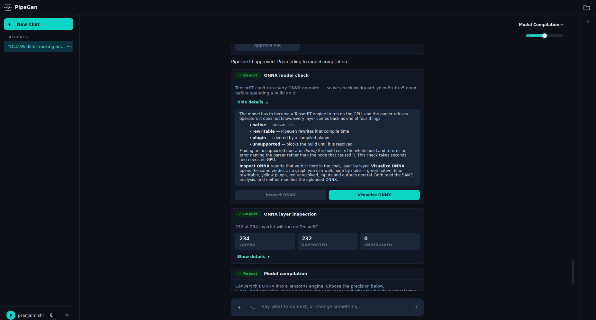 | 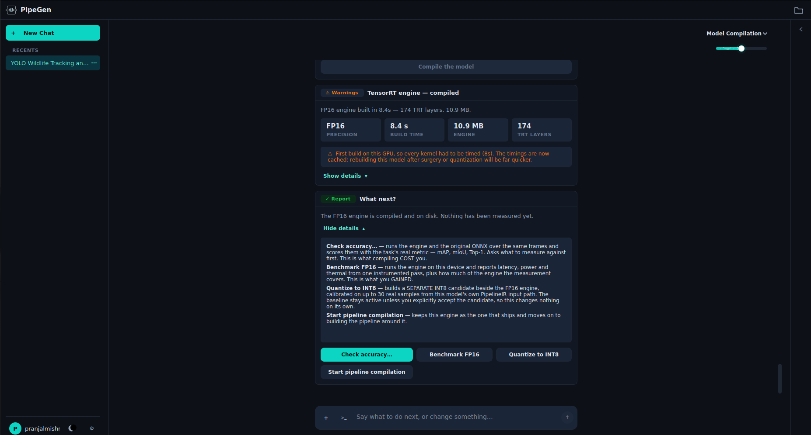 |
| **FP16 engine vs FP32 ONNX: 1.000 on every metric (no accuracy lost)** | **Per-layer FP16 latency (benchmark)** |
| 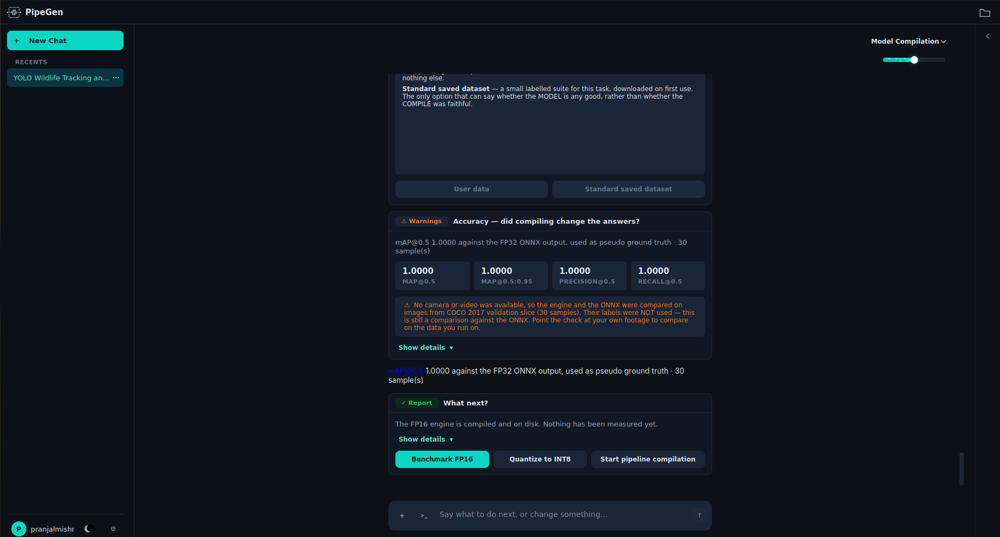 | 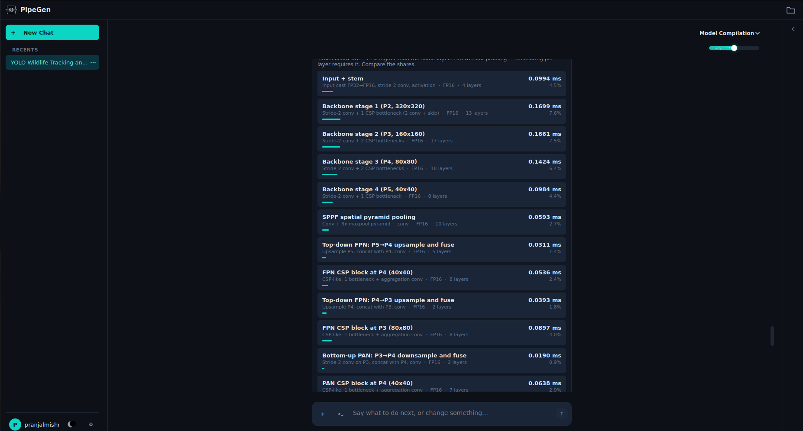 |

The PipeGen **Export Project** folder is [perception/pipegen_export/](perception/pipegen_export/). It contains `run.sh`, the ONNX model, `PipelineIR.json`, configs and parser sources. PipeGen's real JSON output for the test video is [perception/reports/pipegen_metadata_demo_reel.json](perception/reports/pipegen_metadata_demo_reel.json).

## How to run it

### 1. The PipeGen pipeline (export folder)

Requirements: an NVIDIA GPU (driver 560.35.03 or newer), Docker with your user in the `docker` group, and the NVIDIA Container Toolkit. PipeGen, CUDA, TensorRT and DeepStream are **not** needed, because `run.sh` fetches the container image (about 35 GB) on first run.

```bash
# test footage: 7 freely licensed clips -> /home/$USER/wildguard_media/wildguard_demo_reel.mp4
pip install imageio-ffmpeg                       # or: sudo apt install ffmpeg
python3 perception/test_videos/fetch_test_videos.py

# run PipeGen's pipeline (window; add --headless to only write results)
cd perception/pipegen_export
./run.sh --input /home/$USER/wildguard_media/wildguard_demo_reel.mp4 --output ./out
#   ./out/metadata.json = per-frame detections; MQTT on localhost:1883, topic pipegen/detection/wildguard-demo-reel
```

Any video file, `rtsp://` stream or camera (`--input /dev/video0`) works. The first run builds the parser libraries and prepares the engine for your GPU, which takes about a minute.

### 2. Bridge, backend and dashboard on top of PipeGen

```bash
sudo apt install mosquitto mosquitto-clients
pip install -r backend/requirements.txt -r bridge/requirements.txt
(cd frontend && npm install)

mosquitto -c broker/mosquitto.conf &                            # MQTT broker
python3 bridge/bridge.py --pipegen-topic 'pipegen/detection/#' &  # PipeGen -> alerts
(cd backend && python3 main.py) &                               # API + WebSocket on :8001
(cd frontend && npm run dev) &                                  # dashboard on :5173
cd perception/pipegen_export && ./run.sh --input /home/$USER/wildguard_media/wildguard_demo_reel.mp4
```

Open http://localhost:5173. Alerts appear as PipeGen sees each animal. `./scripts/start_all.sh` starts everything at once.

### 3. Score PipeGen's output clip by clip

```bash
python3 tools/video_test.py --pipegen-json perception/pipegen_export/out/metadata.json
```

Tests, with no broker needed: `cd backend && python3 -m pytest -q` (26 tests).

## Results

### Detection model

YOLOv8n trained on the BRA dataset (1,460 train / 182 val images, 10 epochs). Full table in [docs/evidence/model/onnx_fp32_val_metrics.md](docs/evidence/model/onnx_fp32_val_metrics.md).

| Class | AP50 | AP50-95 | Precision @ 0.5 | Recall @ 0.5 |
|---|---|---|---|---|
| Tapir | 0.689 | 0.486 | 0.875 | 0.512 |
| Jaguarundi | 0.801 | 0.503 | 0.920 | 0.742 |
| Maned wolf | 0.725 | 0.520 | 0.929 | 0.619 |
| Puma | 0.751 | 0.453 | 0.651 | 0.549 |
| Giant anteater | 0.753 | 0.555 | 0.875 | 0.600 |
| **All** | **0.744** | **0.503** | **0.826** | **0.595** |

| Training curves | Normalised confusion matrix |
|---|---|
| 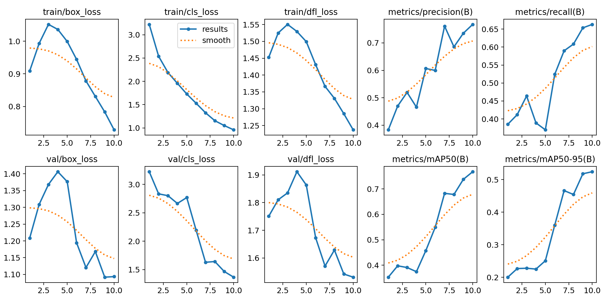 | 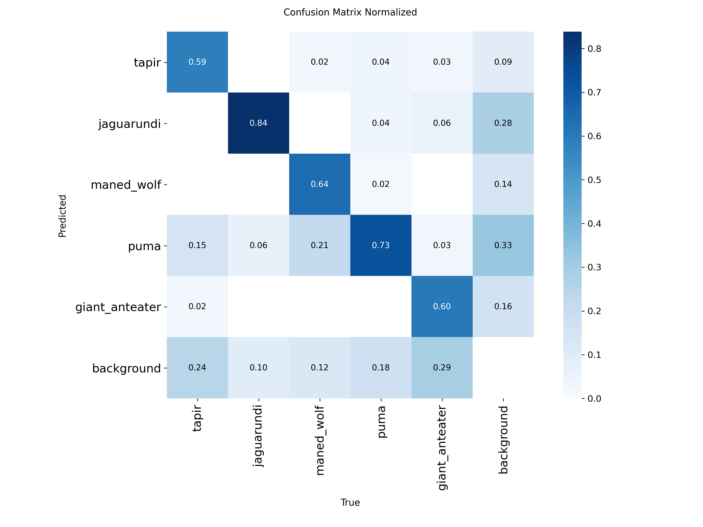 |

A threshold sweep showed that the model labels other animals as puma. Raising puma's alert threshold to 0.60 lifts its precision from 0.65 to 0.78 at the same recall, so the bridge uses that.

### PipeGen on real wildlife video

Seven freely licensed clips (Wikimedia Commons, see [ATTRIBUTION.md](perception/test_videos/ATTRIBUTION.md)): five Brazilian trail-camera clips plus two look-alike tests. PipeGen's own output, scored through the bridge rules ([full report](docs/evidence/video_test/pipegen/report.md)):

| Clip | Expected | Result | First alert |
|---|---|---|---|
| Tapir (infrared trail camera) | tapir | ✅ alerted | 0.63 s |
| Giant anteater (trail camera) | giant anteater | ✅ alerted | 0.63 s |
| Jaguarundi (camera trap) | jaguarundi | ✅ alerted | 0.63 s |
| Puma (Atlantic Forest) | puma | ✅ alerted | 0.63 s |
| Maned wolf (zoo, behind fence) | maned wolf | ❌ missed | — |
| Domestic cat | no alert | ❌ 2 false alarms ("maned wolf") | — |
| Dogs and people | no alert | ❌ 1 false alarm ("maned wolf") | — |

### Performance

| Metric | Value |
|---|---|
| Live pipeline speed | 30 FPS, 0 dropped frames over 3,385 frames (capped by the 30 FPS video) |
| Unthrottled headless run | ≈215 FPS for the whole pipeline (decode, CLAHE, detect, track, MQTT, JSON) |
| Engine | TensorRT FP16, 10.9 MB, 174 layers; about 2.2 ms per frame from PipeGen's per-layer benchmark |
| FP16 vs FP32 accuracy | identical (1.000 agreement, 30 samples) |
| Time to alert | 0.63 s after the animal appears (includes the deliberate 0.5 s confirmation) |

## Dashboard

Captured during the real PipeGen run, with no ESP32 connected, so the board shows *offline* and acknowledgements show *no ACK*.

| Mission control | Live loop |
|---|---|
| 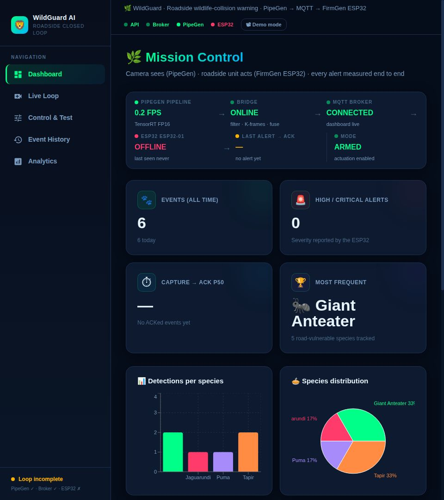 | 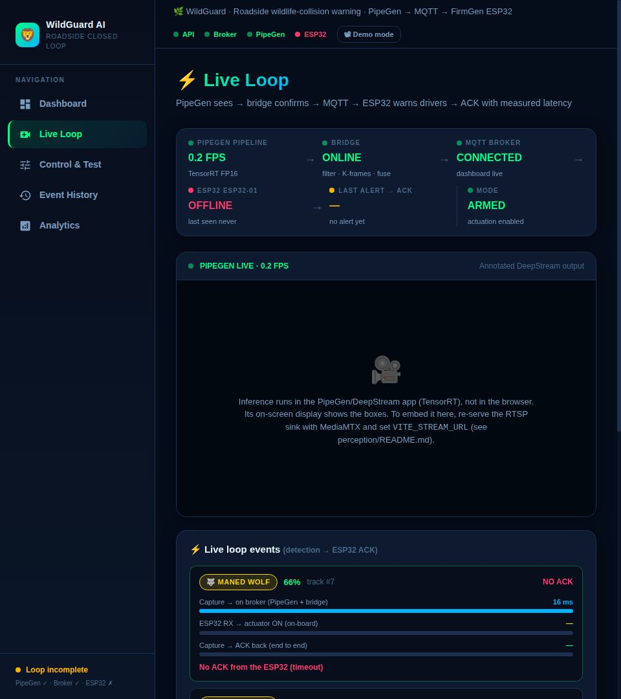 |
| **Event history** | **Analytics** |
| 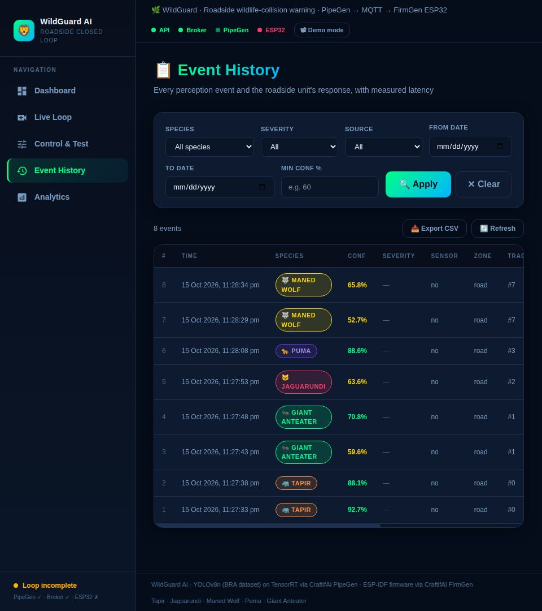 | 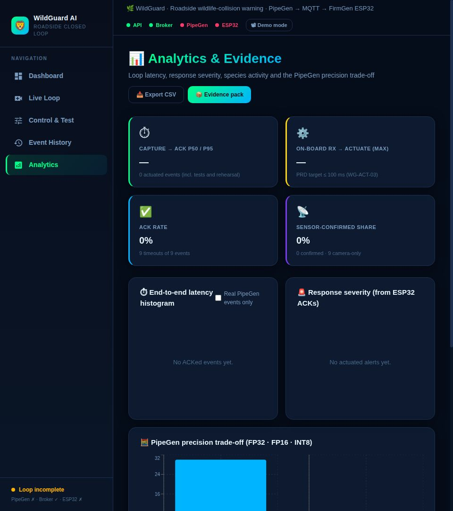 |

## FirmGen roadside unit (in progress)

The ESP32 unit is the "act" half of the loop. Its PRD, [firmware/prd/WildGuard_PRD.md](firmware/prd/WildGuard_PRD.md), defines:

- **Inputs and outputs:** pin map, the MQTT contract, species response profiles and a state machine.
- **Requirements:** 30 requirements, each with a measurable acceptance criterion. They cover connectivity, sensing, event validation, sensor fusion, actuation within 100 ms, acknowledgements, safety (watchdog, buzzer cap, fail-safe mode), logging, telemetry and non-functional limits.

**What happened with FirmGen:**

1. **Install:** FirmGen v0.4.1 ships for Windows and macOS only, while our GPU machine runs Ubuntu, so it was installed on a separate Windows PC.
2. **Toolchain:** ESP-IDF v5.5 setup needed several fixes: a PowerShell execution policy and blocked downloaded scripts, CMake missing from PATH, and the ESP32 compiler missing.
3. **Project and review:** we created the project and uploaded the PRD. FirmGen generated the requirement files, and we started the category-by-category review. We approved the connectivity requirements and answered FirmGen's questions on the onboard LED polarity and the configuration split (Kconfig for credentials, `app_config.h` for pins and thresholds).
4. **Stopped:** without a physical ESP32 the firmware could not be flashed or verified, so the build, traceability report and on-board acceptance are **not done yet**.

| Project setup | Toolchain blocker | Requirements review | Generated files and config decision |
|---|---|---|---|
| 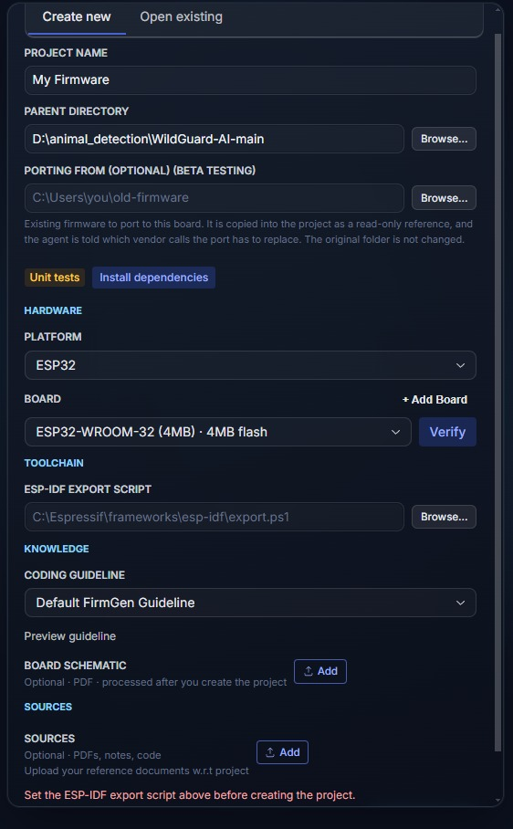 | 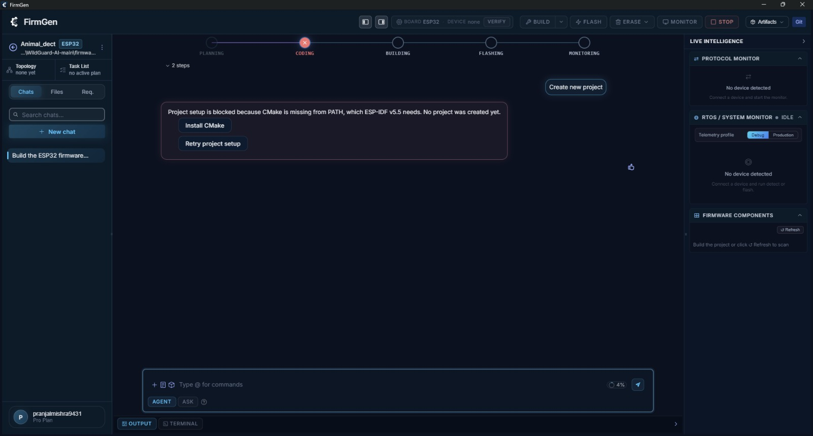 | 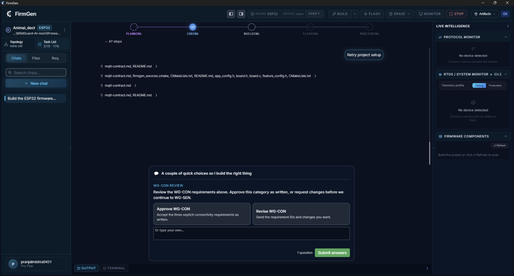 | 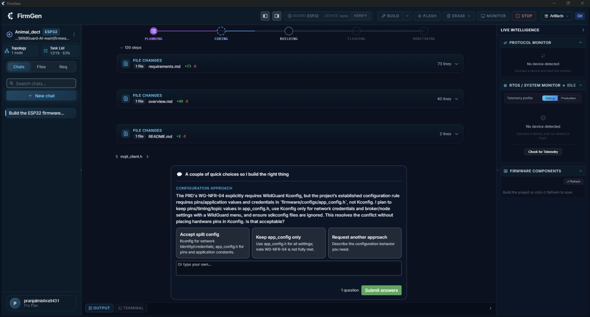 |

Ready for when a board is available: the acceptance runner [tools/hil_acceptance.py](tools/hil_acceptance.py) checks 19 PRD requirements over MQTT against the real board, and wiring is in [docs/hardware/README.md](docs/hardware/README.md).

## Problems we hit and how we fixed them

| # | Problem | Cause | Fix |
|---|---|---|---|
| 1 | PipeGen would not start: "No DISPLAY set" | The shell opened after `newgrp docker` lost the desktop's DISPLAY | Launched with `DISPLAY=:1` and `xhost +local:docker` |
| 2 | PipeGen run failed: "OUTPUT IS BLANK/UNIFORM" | Our test reel had 2 s black gaps between clips, and PipeGen's checker sampled exactly those frames | Rebuilt the reel with straight cuts, so the pipeline itself was fine |
| 3 | PipeGen accuracy check showed 0.000 | "Standard dataset" scores against COCO labels, which our 5 species are not | Used the FP16-vs-FP32 check instead (1.000) and evaluated on our own labelled set |
| 4 | Brief misdetections raised wrong-species alerts | 3 frames at 30 FPS is only 0.1 s | Bridge now also requires the animal to persist ≥ 0.5 s |
| 5 | Cats and dogs labelled as maned wolf | Closed-set model with no "other animal" class | Built a look-alike veto using PipeGen's stock COCO model (removed all false alarms in testing). It is **not yet in the PipeGen pipeline**, which runs one model |
| 6 | Veto silently ignored PipeGen-style messages | One-message-per-object format put the type in a key, and boxes arrived out of order | Fixed parsing and applied the veto retroactively within a frame (tested) |
| 7 | Offline model reference gave wrong boxes | Width and height were swapped in old post-processing | Fixed, and switched to per-class NMS like Ultralytics |
| 8 | Video scorer double-counted alerts at clip cuts | +1 s grace window overlapped the next clip | Each clip is now scored strictly within its own time range |
| 9 | FirmGen not installable on the Linux GPU machine | FirmGen v0.4.1 is Windows/macOS only | Installed on a Windows PC |
| 10 | ESP-IDF install blocked on Windows | Execution policy, unsigned downloaded scripts, CMake and the compiler missing | `Unblock-File`, `install.bat esp32`, CMake on PATH |

## Limitations and next steps

- **Look-alikes:** cats and dogs trigger false alarms. The veto works offline, and the next step is adding the COCO model as a second detector in the PipeGen pipeline, then retraining with background images.
- **Tapir recall:** about 0.5 per frame at the alert threshold. Tracking helps, but more training data for this most critical species comes first (the current model trained for only 10 epochs on CPU).
- **Tested on recorded video only:** not yet on a live roadside camera at night, in rain or at road distances.
- **No board yet:** the ESP32 warning sign is specified, but not built or flashed, so drivers are not yet warned automatically.
- **Edge deployment:** INT8 and a Jetson pole-mounted unit are not yet tested.
- **Deployment:** solar power, LoRa where there is no Wi-Fi, multi-camera coverage, and TLS on the broker.

## Repository layout

| Folder | Contents |
|---|---|
| [perception/](perception/README.md) | PipeGen export folder, stage screenshots, reports, ONNX export script, test videos |
| [firmware/](firmware/README.md) | FirmGen PRD and FirmGen progress screenshots |
| [bridge/](bridge/bridge.py) | PipeGen output → one confirmed alert per animal |
| [backend/](backend/main.py) | FastAPI: MQTT observer, SQLite, WebSocket, control and test API, evidence pack, 26 tests |
| [frontend/](frontend/README.md) | React mission-control dashboard |
| [shared/](shared/wg_contract.py) | MQTT contract used by every Python component |
| [tools/](tools/) | Video test, model evaluation, hardware acceptance runner, rehearsal stand-ins |
| [scripts/](scripts/), [broker/](broker/mosquitto.conf) | Start/stop scripts, environment check, Mosquitto config |
| [docs/](docs/) | Architecture, MQTT contract, hardware, project description, evidence, demo video |
| [training/](training/) | Pre-existing: training notebook, dataset config, runs, offline ONNX reference |
| [legacy/](legacy/README.md) | Pre-existing: old Arduino sketch, not used |

**Built for this hackathon:** the PipeGen pipeline and export, bridge, backend, dashboard, FirmGen PRD, evaluation and test tools, and all evidence. **Pre-existing:** the YOLOv8n training on the BRA dataset and an earlier dashboard prototype, whose CPU inference path was removed.

## Credits

- **Tools:** CraftifAI PipeGen v0.5.1 and FirmGen v0.4.1.
- **Dataset:** BRA dataset, Ferrante et al., SIBGRAPI 2022.
- **Test videos:** Wikimedia Commons under CC BY 4.0, CC BY-SA and public domain, with authors in [perception/test_videos/ATTRIBUTION.md](perception/test_videos/ATTRIBUTION.md).
